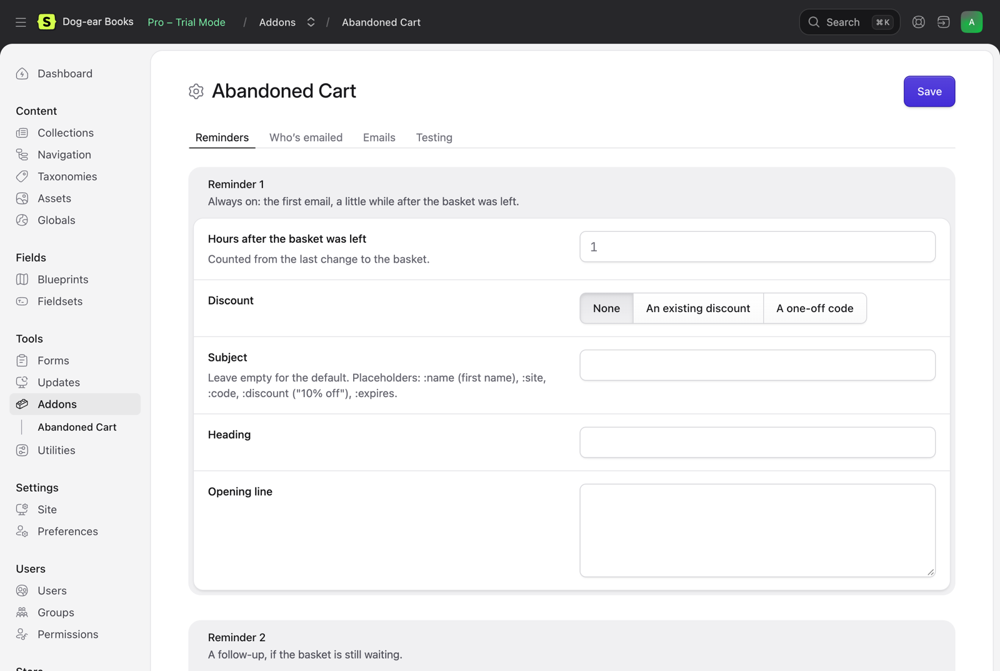

# Configuration

## In the Control Panel



Tools → Addons → Abandoned Cart → Settings (`/cp/addons/abandoned-cart-statamic/settings`), or **Settings** on Store → Abandoned Carts. Anything left empty uses `config/abandoned-cart.php`, or the default wording in the site's language.

**Reminders**

Three reminders, each with:

- **Send this reminder**: reminders 2 and 3 can be switched off. Reminder 1 is always on. Reminder 3 is off by default: a discount there can teach shoppers to wait for one.
- **Hours after the basket was left**: counted from the last change to the basket. Whole hours, 1 or more. Defaults: 1, 24 and 72.
- **Discount**: none, an existing discount (**Which discount** lists your Cargo discounts with a code), or a one-off code (**Type**: percentage off, amount off or free shipping, and **Amount**: 10 for 10%, or 5 for 5.00 off). See [Discounts](discounts.md).
- **Subject**, **Heading** and **Opening line**: this reminder's wording.

See [Reminders](reminders.md) for how the timing works.

**Who's emailed**

- **Consent**: opt-in (a box to tick) or soft opt-in (a box to say no). See [Consent](consent.md).
- **Opt-in wording** or **Soft opt-in wording**: next to the box, and saved with each basket.
- **Shoppers**: everyone, guests only, or signed-in customers only.
- **Smallest basket**: baskets worth less than this, in the site's currency, aren't emailed.
- **Never email**: addresses or domains, one a line (`staff@shop.com`, `shop.com`). A domain covers its subdomains too.

**Emails**

- **Logo** and **Brand colour**. The logo field shows once the site has an asset container (the first one is used). Text on the brand colour turns dark or white, whichever reads better.
- **Button**, **Under the code** and **Footer**: wording in every reminder.
- **Link works for (days)**: how long the link in a reminder works, and any one-off code. Never past the day Cargo deletes the basket.

**Testing**

- **Test mode** and **Test addresses**: while it's on, only baskets with these addresses are emailed. See [Reminders](reminders.md#test-mode).

Placeholders in the wording: `:name` (the shopper's first name, or "there"), `:site`, `:code`, `:discount` ("10% off") and `:expires` (the day the link stops working). Wording you type here is used for every site. Leave it empty to use the wording in `lang/`, in each site's language (see [Emails](emails.md)).

## `config/abandoned-cart.php`

Publish it to change it:

```bash
php artisan vendor:publish --tag=abandoned-cart-config
```

| Option | Default | |
| --- | --- | --- |
| `reminders` | 1, 24 and 72 hours | The three reminders: `enabled`, `delay` (hours after the basket last changed) and `discount`. The third is off, with 10% off. See below. |
| `consent` | `'opt_in'` | `'opt_in'` or `'soft_opt_in'`. See [Consent](consent.md). |
| `audience` | `'all'` | `'all'`, `'guests'` (no account) or `'customers'` (signed in). |
| `minimum_total` | `null` | Baskets worth less than this aren't emailed, in the site's currency (`25` for 25.00). Null for any amount. |
| `exclude` | `[]` | Addresses or domains never emailed: `['staff@shop.com', 'shop.com']`. |
| `link_days` | `7` | Days the link in a reminder works, and any one-off code. Never past the day Cargo deletes the basket. |
| `redirect` | `'/checkout'` | Where the shopper goes once their basket is back. A path on the basket's own site, or a full URL. |
| `login_url` | `null` | Where a customer is sent to sign in, for a basket that belongs to their account. Null links to the home page. |
| `attribution_days` | `7` | An order from the same address within this many days of bringing a basket back with a reminder's button counts as recovered. See [Reminders](reminders.md#orders). |
| `discount_prefix` | `'COMEBACK'` | One-off codes look like `COMEBACK-7KQ2XM`. Letters and numbers only. |
| `test_mode` | `false` | Only email the `test_recipients`. |
| `test_recipients` | `[]` | The addresses emailed in test mode. |
| `per_minute` | `120` | The most reminders sent in a minute. See [Reminders](reminders.md#how-many-at-once). |
| `email.bcc` | `null` | An address that gets a copy of every reminder (not test reminders). |
| `schedule` | `true` | Schedule `abandoned-cart:send` (every minute) and `abandoned-cart:prune` (daily). |
| `retention.anonymise` | `90` | Days after the basket last changed when the email address and name are removed. Null keeps them. |
| `retention.delete` | `365` | Days after which the record goes altogether. Null keeps them. |
| `views.*` | | The views the emails and the pages are drawn with. See [Emails](emails.md). |
| `database.connection` | `null` | The database connection for the tables. Null is your default. |

A reminder's `discount` is `null` (none), the handle of one of your Cargo discounts, or a one-off code made for each email:

```php
'reminders' => [
    ['enabled' => true, 'delay' => 1, 'discount' => null],
    ['enabled' => true, 'delay' => 24, 'discount' => 'come-back'],
    ['enabled' => true, 'delay' => 72, 'discount' => ['type' => 'percentage_off', 'value' => 10]],
],
```

One-off types: `['type' => 'percentage_off', 'value' => 10]` (10% off), `['type' => 'amount_off', 'value' => 5]` (5.00 off, in the site's currency) and `['type' => 'free_shipping']`.

The settings in the Control Panel win over `reminders`, `consent`, `audience`, `minimum_total`, `exclude`, `link_days`, `test_mode` and `test_recipients` once they're saved. `per_minute`, `redirect`, `login_url`, `attribution_days` and `retention` are only in the config.

Two settings from Cargo matter too, in `config/statamic/cargo.php`: `carts.purge_abandoned_carts_after` (30 days), as the addon never emails a basket Cargo is about to delete (see [Reminders](reminders.md#cargo-deleting-old-baskets)); and the sites' `currency` attribute, for the totals.
