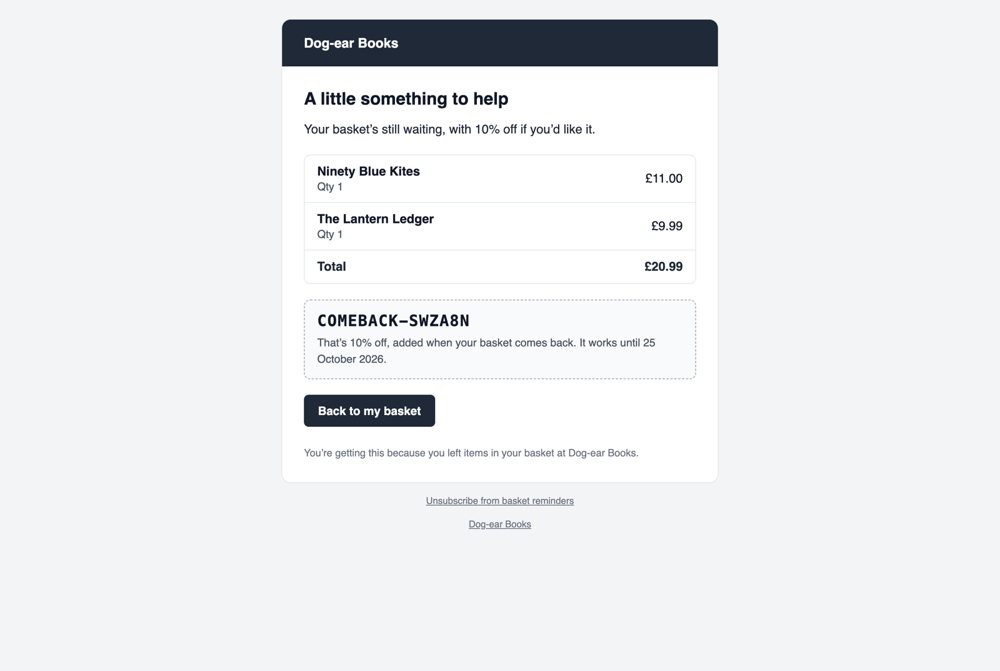

# Emails



Up to three reminders per basket, all from your site's mailer. Each has:

- a heading and an opening line;
- what's in the basket (each item, its variant, quantity and total, as it was when the basket last changed) and the total;
- any discount code, with a line about it;
- a button back to the basket (see [Restoring a basket](restoring.md));
- a footer, and an unsubscribe link.

They're HTML with a plain-text version, laid out with tables and inline styles so they look right in every mail app. They're sent by `abandoned-cart:send`, so no queue is needed. See [Reminders](reminders.md) for who gets them, and when.

## Wording and look

Change it in Tools → Addons → Abandoned Cart → Settings (see [Configuration](configuration.md)):

- for each reminder: **Subject**, **Heading** and **Opening line**;
- for every reminder: **Button**, **Under the code** (the line under a discount code) and **Footer**;
- **Logo** and **Brand colour**. The colour is the band across the top and the button; text on it turns dark or white, whichever reads better.

The default wording:

| | Reminder 1 | Reminder 2 | Reminder 3 |
| --- | --- | --- | --- |
| Subject | You left something in your basket | Your basket at :site is waiting | A little something for your basket at :site |
| Heading | Still thinking it over? | Your basket's still here | A little something to help |
| Opening line | Hi :name, we've saved your basket at :site. Pick up where you left off whenever you're ready. | We've kept it for you, but nothing's reserved: things can sell out. | Your basket's still waiting, with :discount if you'd like it. |

Button: "Back to my basket". Under the code: "That's :discount, added when your basket comes back. It works until :expires." Footer: "You're getting this because you left items in your basket at :site."

Placeholders:

| | |
| --- | --- |
| `:name` | The shopper's first name, or "there" when there's no name. |
| `:site` | The site's name. |
| `:code` | The discount code, if there is one. |
| `:discount` | What the code is worth: "10% off", "£5.00 off", "free delivery". |
| `:expires` | The day the link (and any one-off code) stops working, written the site's way: "25 October 2026" on an `en_GB` site. |

What you type is text, not HTML: it's escaped, and so are shoppers' names.

## Languages

Each reminder is sent in the language of the site the basket was on, with prices in that site's currency. The wording comes from `lang/en/messages.php`. To translate it, publish the translations and add a folder for each language:

```bash
php artisan vendor:publish --tag=abandoned-cart-translations
```

Then copy `lang/vendor/abandoned-cart/en/messages.php` to `lang/vendor/abandoned-cart/fr/messages.php` (say), and translate it. The pages the links open, the consent wording and the "Your basket's back" message are in there too. Wording typed in the settings is used for every site: leave it empty to use the translations.

## Changing the emails

Publish the views and edit them:

```bash
php artisan vendor:publish --tag=abandoned-cart-views
```

| View | |
| --- | --- |
| `emails/layout.blade.php` | The frame every reminder shares: logo, brand colour, site link. |
| `emails/reminder.blade.php`, `emails/reminder-text.blade.php` | A reminder, HTML and plain text. `$step` is 1, 2 or 3. |
| `basket.blade.php` | The page the link in a reminder opens: the basket now, and the button. |
| `page.blade.php` | The other pages: link expired, already ordered, sign in, unsubscribe. |

In a reminder, each of `$items` has its product's entry as `$item['entry']`, so its other fields (an image, say) are `$item['entry']?->value('image')`, and `$item['url']` is its page. Or point `views.*` in the config at views of your own.

## Test reminders

To see a reminder as a shopper would, open a basket's page in Store → Abandoned Carts, choose the reminder under **Send yourself a test**, and click **Send test**. It goes to your own email address (the user signed in), with that basket's items and the reminder's wording and code.

A test changes nothing about the basket: it doesn't count as a reminder sent, isn't counted in the reports, and goes even if the basket couldn't be emailed. One-off codes show as `COMEBACK-TEST`, and no discount is made. The link opens the basket's page with a note that it's a test, and no button. Test reminders aren't sent to the `email.bcc` address. Sending one needs the "Send test reminders and stop reminders" permission.

## Unsubscribing

Every reminder has an unsubscribe link. It opens a page with an **Unsubscribe** button: only the button unsubscribes, as mail apps open links by themselves. Each reminder also has the headers mail apps use for their own unsubscribe button (`List-Unsubscribe`, with one-click unsubscribing as in RFC 8058, `List-Unsubscribe-Post: List-Unsubscribe=One-Click`), which Gmail and Yahoo ask bulk senders for. The unsubscribe link never expires.

Unsubscribing stops every basket reminder to that address. See [Consent](consent.md#unsubscribing).

## No tracking pixel

The reminders have no open-tracking pixel. "Opened the link" on a basket's page in the Control Panel is when the link was first opened, which a mail app's link checker can do too; "Brought the basket back" is the button, which only a person clicks. See [The Control Panel](control-panel.md).

## Testing locally

Use a local mail catcher such as [HELO](https://usehelo.com), Mailpit or Mailtrap. With HELO in Laravel Herd:

```env
MAIL_MAILER=smtp
MAIL_HOST=127.0.0.1
MAIL_PORT=2525
MAIL_USERNAME="${APP_NAME}"
```

HELO puts each username's mail in its own inbox. Then:

1. Add something to your basket, and go through the checkout's customer step with your email address, ticking the box.
2. Wait an hour (the shortest reminder), and run `php please abandoned-cart:send`. Or send yourself a test from the basket's page in Store → Abandoned Carts straight away.
3. Open the reminder, click the button, and check your basket is back.

Or with `MAIL_MAILER=log`, the emails are written to `storage/logs/laravel.log`.
